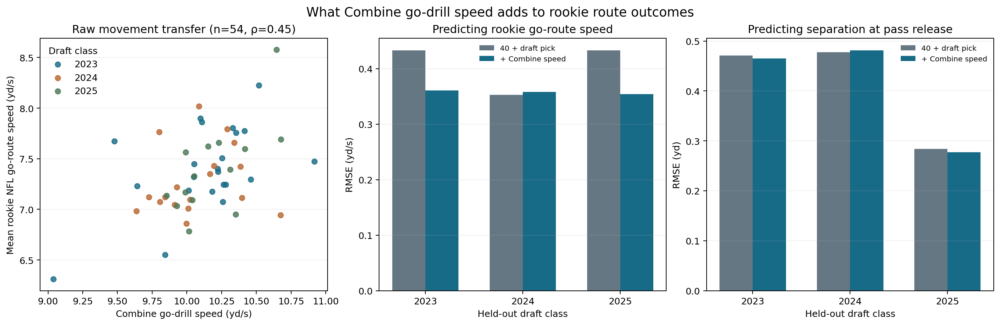

# NFL Big Data Bowl 2027: Combine go-drill speed to rookie NFL routes

This project studies whether sensor speed on the Combine `GO_ROUTE_RIGHT` drill adds useful information about rookie NFL `GO` route speed and separation beyond official 40-yard time and draft position. It uses both Combine and NFL game tracking from the [NFL Big Data Bowl 2027](https://www.kaggle.com/competitions/nfl-big-data-bowl-2027).

## Main result

For 54 eligible wide receivers, adding the Combine sensor measure lowered pooled draft-class-held-out error for rookie go-route speed from **0.408 to 0.358 yd/s**. The approximate paired interval for the error change includes zero, so the gain remains uncertain. The same feature barely changed separation error (**0.433 to 0.431 yd**). The possible use is a post-draft movement baseline for video review, not a validated player ranking.



## Start with the notebook

[notebooks/go_route_transfer.ipynb](notebooks/go_route_transfer.ipynb) is the main Jupyter analysis and contains the methods, code, output tables, and figure. Run it with the competition data attached in Kaggle, or locally in Jupyter with the CSVs in `data/raw/`. The notebook searches `/kaggle/input` automatically. Locally, it reads game tracking directly from the downloaded ZIP at `~/Downloads/nfl-big-data-bowl-2027.zip` when the large CSVs have not been extracted. Set `BDB_DATA_DIR` and `BDB_ARCHIVE` to use other locations.

To run the same focused analysis from a terminal after installing `requirements.txt`:

```bash
python src/go_transfer.py
```

The earlier [exploratory notebook](notebooks/nfl_big_data_bowl_2027.ipynb) and `src/analyze_wr.py` show the broader route-family search that motivated the focused study. Its candidate associations are exploratory and should not be treated as independently validated findings.

## Submission files

- [writeup.md](writeup.md): competition-style narrative, below 2,000 words with one figure.
- [figures/go_route_transfer.png](figures/go_route_transfer.png): summary figure for the write-up media gallery.
- `outputs/rookie_go_cv_summary.csv`, `outputs/rookie_go_coverage_check.csv`, `outputs/rookie_go_weekly_translation.csv`, and `outputs/rookie_go_audit.json`: generated results, weekly pilot, and coverage audit.

Raw competition CSVs, the downloaded ZIP, and player-level generated tables are excluded from Git. To enter the competition, attach a **public Kaggle notebook** to the Kaggle write-up, add the figure to its media gallery, and submit through the competition page. Publishing this repository alone is not a Kaggle submission. This competition does not award Kaggle competition points or medals.
